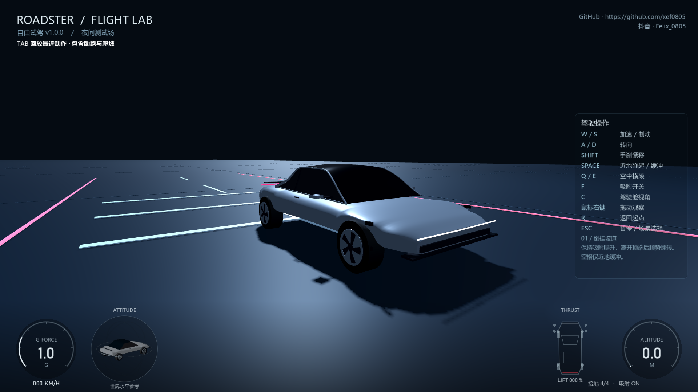
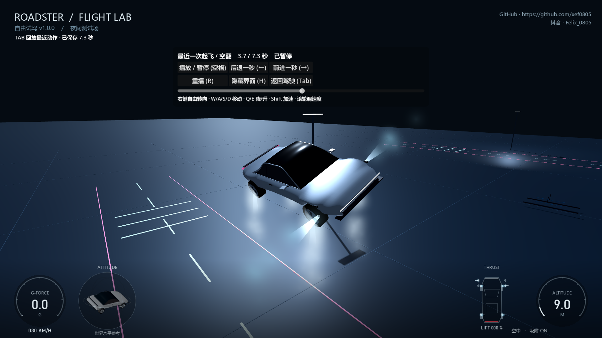

# Roadster2 Simulator

Windows 单机自由试驾游戏。银灰色 Roadster 风格跑车、夜间测试场、倒挂弧形坡道与五车飞越场景，使用 Godot 4.7.2、GDScript、Jolt 和固定 120Hz 物理。

作者水印：**GitHub https://github.com/xef0805 / 抖音 Felix_0805**。

## 下载与运行

[下载 Windows 最新版](https://github.com/xef0805/Roadster2-simulator/releases/latest/download/RoadsterLab-Windows.zip) · [下载独立 Godot 源工程](https://github.com/xef0805/Roadster2-simulator/releases/latest/download/RoadsterLab-source.zip)

解压 Windows 包后双击 `RoadsterLab/RoadsterLab.exe`，默认无边框全屏，不需要安装 Godot。首个正式版本 **v1.0.0**，见 [GitHub Releases](https://github.com/xef0805/Roadster2-simulator/releases/tag/v1.0.0)。

银灰车身采用圆润曲面，侧面移除黑色装饰片，落地喷气保留较密白雾并将扩散范围收拢至车身附近。回放按录像状态播放行驶、轮胎、喷气及落地声，暂停同步停声。



## 操作

| 按键 | 作用 |
|---|---|
| W / S | 加速 / 刹停；停稳后松开再按 S 倒车 |
| A / D | 转向；空中调航向 |
| Shift | 手刹漂移 |
| 空格 | 近地弹起、落地缓冲；高空保留喷气动画与声音，不能持续升高 |
| Q / E | 空中左右喷气横滚 |
| F | 开关吸附 |
| C | 切换车外与驾驶舱 |
| 右键拖动 / 滚轮 | 环顾 / 拉近拉远，松开后平滑归位 |
| Tab | 查看或退出最近一次起飞、空翻回放 |
| R / Esc | 重置 / 暂停与场景选择 |

回放保留最多 12 秒助跑记录，进入弧形坡道后持续录制整段爬升，落地约 0.8 秒后保存。回放中右键转向、WASD 自由移动、**Q/E 降低/升高、空格暂停/播放、←/→ 前后跳一秒、R 从头重播、H 隐藏/显示界面**，也可拖动进度条或点击重播、隐藏按钮。镜头默认 32m/s，Shift 加速、滚轮调整速度。默认跟随车辆，调整镜头后进入自由观察。界面不会自动隐藏，隐藏后按 H 恢复，水印保持显示。驾驶和回放的右键上下拖动均已反转。暂停时仍能移动镜头，Tab 或 Esc 返回原驾驶位置与速度。仅保留本次运行最近一次完整动作，最长约 120 秒，不是视频导出功能。

车身按参考图调整楔形车头、贯穿式前灯、肩线、溜背车顶和轮毂。侧窗保持不透明；机器人仅在驾驶舱内后视镜的实时画面中可见。Esc 暂停菜单采用暗色遮罩、主按钮和场景卡片布局。



## 工程与更新

Godot 导入 `work/game/project.godot`，按 F5 运行。项目与发布位置固定，后续直接修改和覆盖：

- `work/game/`：唯一开发源工程。
- `outputs/RoadsterLab/`：可运行游戏与中文说明。
- `outputs/RoadsterLab-source/`：用于交付的源工程副本。
- `outputs/验证资料/`：最新检查报告与截图。
- 两个发布 ZIP 始终使用 `RoadsterLab-Windows.zip`、`RoadsterLab-source.zip`。

不提交 Godot 引擎、导入缓存、参考视频或大型 exe。Windows 二进制与源工程 ZIP 放在 GitHub Releases。

在仓库目录运行（需要 Python；将 GODOT_BIN 指向本机 Godot 4.7.2 可执行文件）：

```powershell
$env:GODOT_BIN = 'C:\path\to\Godot_v4.7.2-stable_win64_console.exe'
python work/run_godot.py --editor
python work/verify.py
python work/run_godot.py --headless --export-release 'Windows Desktop'
python work/check_release.py
python work/package.py
```

导出前在 Godot 中安装对应版本的 Windows 标准导出模板。检查报告写入固定的 `work/checks/`；发布前自动验证不同帧率的驾驶、弹道、回放与喷气，并检查独立 exe 全屏启动、实际画面和短时性能。

车辆和机器人为自制简化模型，推力、吸附、近地范围等为游戏参数，不代表真实车辆技术规格。音效为原创合成。项目沿用仓库 MIT 许可证；Godot 与其组件声明见 `work/game/GODOT-LICENSES.txt`。
