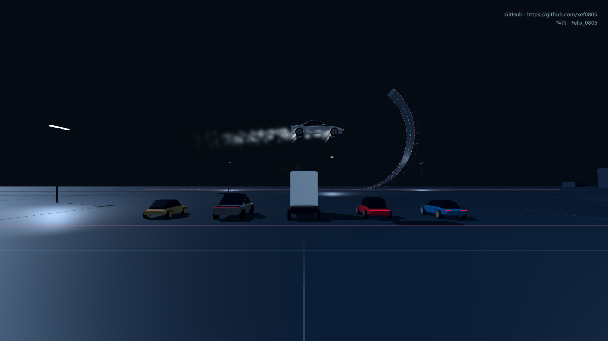
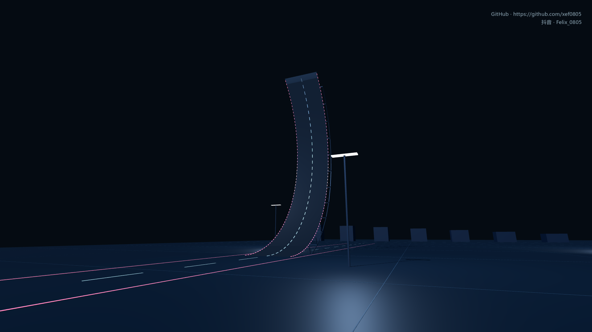
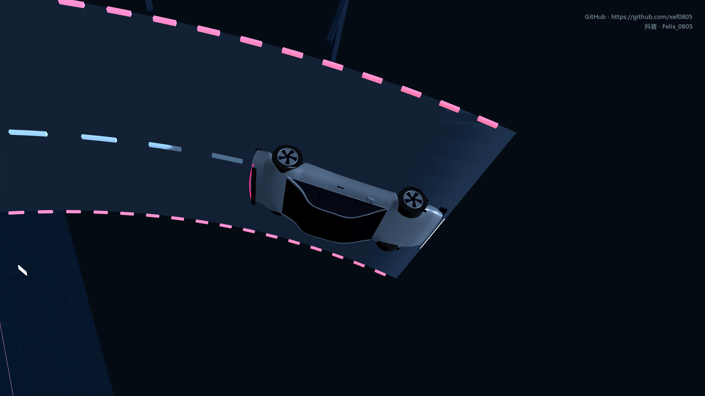

# Roadster2 Simulator

驾驶银灰色 Roadster，在夜间测试场挑战倒挂道路、喷气起跳与飞越车队。支持漂移、空中翻滚、驾驶舱视角，以及带声音的自由视角回放。

**[下载 Windows 游戏](https://github.com/xef0805/Roadster2-simulator/releases/latest/download/RoadsterLab-Windows.zip)** · [全部版本](https://github.com/xef0805/Roadster2-simulator/releases) · [安全与下载说明](SECURITY.md)

解压后运行 `RoadsterLab/RoadsterLab.exe`，无需安装 Godot，默认无边框全屏。

## 两个试驾场景

- **倒挂道路**：从平地沿弧形坡道爬升，倒挂行驶、脱离坡顶，再翻转落地。
- **飞越车队**：越过 Cybercab、Cybertruck、Semi、Model Y 和 Model 3，尝试喷气横滚与缓冲降落。

夜间测试道路：

倒挂近景：

以上均为游戏实机截图，参考视频机位拍摄。

## 操作

| 按键 | 功能 |
|---|---|
| W / S、A / D | 加速／制动／倒车、转向 |
| Shift | 手刹漂移 |
| 空格 | 近地起跳、落地缓冲 |
| Q / E | 空中左右喷气横滚 |
| F / C | 吸附开关／切换视角 |
| 鼠标右键拖动、滚轮 | 环顾、调整距离 |
| R / Esc | 回到起点／暂停 |
| Tab | 查看最近一次完整动作回放 |

回放中：**WASD** 移动、**Q/E** 升降、**右键** 转向、**Shift／滚轮** 调速；**空格** 暂停／播放、**←/→** 调整进度、**R** 重播、**H** 隐藏／显示界面、**Tab/Esc** 返回驾驶。

作者：[GitHub · xef0805](https://github.com/xef0805) / 抖音 **Felix_0805**。采用 [MIT 许可证](LICENSE)。本项目为非官方模拟游戏，车辆与喷气参数用于游戏，不代表 Tesla 的真实技术规格。
